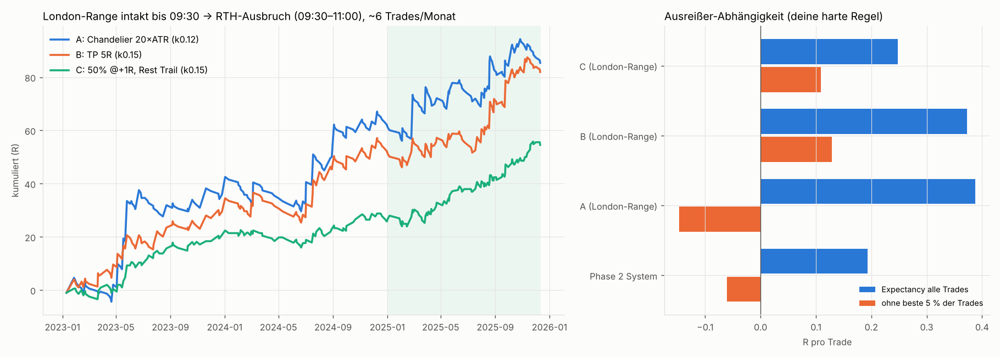

# NQ Continuation Research – Phase 3: Zeitbasierte Ansätze mit Trailing

Code: `research/p3/`. Der Simulator ist derselbe verifizierte wie in Phase 2: Bar-Close-Management, Stop zuerst, Gap-Fills zum schlechteren Open, Tageslimit ±1R, eine Position gleichzeitig. Die Stops skalieren mit **DR** = Ø RTH-Range der 10 *vorherigen* Sessions (kausal, ~230–400 Pkt).

---

## 0. Ergebnis

1. **Reine Uhrzeit-Einstiege** (zur Uhrzeit T in Richtung der Bewegung seit einem Anker): In-Sample bis +0.23R, **Out-of-Sample 2025 nur −0.06 bis +0.12R**. → verworfen.
2. **Zeitdefinierte Range + Ausbruch** ist die stärkste Struktur der gesamten Research. Bleibt die **London-Range (02:00–08:00 ET) bis 09:30 intakt** und wird sie zwischen 09:30 und 11:00 per 1m-Schlusskurs gebrochen, liefert die Folgebewegung bis Handelsende **+0.38 bis +0.53R pro Trade**. 87 % von 750 Nachbarvarianten sind in allen Jahren positiv.
3. **Aber:** Der Vorteil kommt fast vollständig von wenigen Trendtagen. Die **Top-5-Trades (von 220) liefern 77 % des Gewinns**, und ohne die besten 5 % der Trades ist die Expectancy **negativ**. Das verletzt deine harte Regel („nicht: wenige riesige Gewinner retten die Strategie“).
4. Kappt man die Gewinner (TP oder Teilverkauf), besteht die Regel nur auf einer **schmalen Parameter-Insel** (Stop = 0.15·DR). Der ehrliche Walk-Forward mit dem robusten Auswahlkriterium bringt nur **+0.10R** OOS.
5. **Grundsätzlicher Befund über alle drei Phasen:** Jeder Continuation-Kandidat, auch das Phase-2-System, wird ohne seine besten 5 % Trades negativ. Continuation bei NQ wird über den rechten Tail bezahlt (Trendtage, Läufer), nicht über viele kleine Gewinne. Frühes BE und aggressives Trailing liegen auch hier bei ≈ 0R (Winrate 60–75 %).

**Es gibt keinen Kandidaten, der alle deine Bedingungen gleichzeitig erfüllt.** Das Pine Script schreibe ich erst nach deiner Entscheidung (siehe 6.).

---

## 1. Uhrzeit-Einstiege (CHART → OBSERVATION → HYPOTHESIS)

Karte: Einstiegszeit (24 h; 15-min-Raster nachts, 5-min-Raster in RTH) × Anker (Vortagesschluss, 18:00-Open, 09:30-Open, letzte 15/30/60/120 min) × Haltedauer 15–120 min, je Jahr (`p3/timemap.py`).

- Effekte sind klein: ~1–3.5 % der Tagesrange (≈ 3–10 Pkt) über 60–120 min.
- 19 % der Kombinationen sind in allen drei Jahren positiv, unter reinem Zufall wären ~12.5 % zu erwarten. Es gibt also etwas Struktur, aber viele Einzelspitzen.
- Zusammenhängende Plateaus gibt es nur bei **10:00–10:25** (Richtung der letzten 60 min, Halten 120 min) und **12:40–13:10** (Richtung vs. 09:30-Open, Halten 60 min). 14:35–15:45 ist fast nie robust.

Als Trades mit Stop 0.05–0.20·DR und 20+ Trailing-Varianten, gemittelt über alle Zeitpunkte des Plateaus:

| Slot | bester IS | OOS 2025 |
|---|---|---|
| AM, Richtung letzte 60 min | +0.15R | +0.02 bis +0.07R |
| AM, Richtung vs. 09:30-Open | +0.19R | +0.08 bis +0.12R |
| Mittag, Richtung vs. 09:30-Open | +0.18R | **−0.06 bis −0.02R** |
| Mittag, Richtung letzte 30 min | +0.24R | +0.01 bis +0.06R |

→ Out-of-Sample bricht es ein. **Verworfen.**

## 2. Zeitdefinierte Ranges → Ausbruch (Continuation)

Getestete Ranges: Opening Range 09:30+5/15/30 min, Initial Balance 60 min, Pre-Market 08:00–09:30, Overnight 18:00–09:30, Asia 18:00–02:00, London 02:00–08:00, Lunch 11:30–13:00, 12:00–13:00. Der erste 1m-Schlusskurs außerhalb der Range im Ausbruchsfenster löst einen Entry zum nächsten Open aus (`p3/orb.py`).

- In allen Jahren positiv: **London-Range** (+0.20/+0.23R), Pre-Market-Range (+0.20R), Opening Range 5 min (+0.12R).
- Negativ: Asia (2025 −0.17 bis −0.24R), Lunch, 12:00–13:00.
- **London-Range-Plateau** (Start 00–03 Uhr, Ende 07:00–09:30, Fensterende 10:00–12:00, Stop 0.08–0.20·DR): **96 % von 600 Varianten in allen Jahren positiv**, Median +0.18R.
- Die Aufteilung nach Ausbruchszeit macht den Unterschied: Ausbrüche *vor* 09:30 bringen +0.10 bis +0.16R, Ausbrüche *in RTH* +0.37 bis +0.47R. → Variante „Range bis 09:30 intakt“ (`p3/rthbreak.py`).

## 3. Management auf „London-Range intakt → RTH-Ausbruch“ (~0.3 Trades/Tag)

| Management-Familie (Mittel über Stops 0.08–0.20·DR) | IS 2023–24 | OOS 2025 | Winrate |
|---|---|---|---|
| Halten bis 15:54 | +0.50 | +0.25 | 24 % |
| ATR-Chandelier (5–30 × ATR1m) | +0.42 | +0.22 | 29 % |
| Zeit-Exit 60–240 min | +0.38 | +0.19 | 31 % |
| BE bei +0.5/1/2R | +0.29 | +0.16 | 27 % |
| Partial 50 % + Runner | +0.22 | +0.17 | 45 % |
| Swing-Trail | +0.22 | +0.19 | 34 % |
| Feste TP 1–5R | +0.20 | +0.18 | 38 % |
| R-Trailing (0.5–2R) | +0.15 | +0.20 | 45 % |
| Hybrid | +0.13 | +0.21 | 37 % |
| **Aggressives BE (+0.2R) + enges Trailing** | **−0.03** | +0.05 | **62 %** |

## 4. Die drei Kandidaten und die Ausreißer-Regel



| | A: Chandelier 20×ATR1m, Stop 0.12·DR | B: TP 5R, Stop 0.15·DR | C: 50 % @ +1R, Rest Trail 1R ab +2R, Stop 0.15·DR |
|---|---|---|---|
| Trades/Tag · /Monat | 0.30 · 6.3 | 0.30 · 6.3 | 0.30 · 6.3 |
| Winrate | 24 % | 31 % | 43 % |
| Ø Gewinn / Ø Verlust | +4.69R / −0.98R | +3.47R / −0.99R | +1.53R / −1.00R |
| **Expectancy** (netto 0.6 Pkt) | **+0.39R** (+0.37) | **+0.37R** (+0.36) | +0.25R (+0.23) |
| Profit Factor | 1.52 | 1.54 | 1.60 |
| Max DD / max. Verlustserie | 12.9R / 12 | 11.2R / 11 | 6.6R / 5 |
| 2023 / 2024 / 2025 | +0.58 / +0.41 / +0.25 | +0.48 / +0.35 / +0.32 | +0.33 / +0.08 / +0.31 |
| Long / Short | +0.26 / +0.53 | +0.10 / +0.67 | +0.12 / +0.38 |
| Positive Quartale | 67 % | 92 % | 83 % |
| **Ohne beste 5 % Trades** | **−0.15R** | +0.13R | +0.11R |
| Anteil der Top-5-Trades am Gewinn | **77 %** | 31 % | 31 % |
| Median-Stop | 29 Pkt | 36 Pkt | 36 Pkt |

- **A** erreicht das Ziel von +0.35R/Trade, hängt aber an wenigen Trendtagen. Damit verletzt A die harte Regel.
- **B und C** bestehen die Ausreißer-Regel, aber **nur bei Stop 0.15·DR**. Bei 0.10, 0.20 oder 0.25·DR fallen sie durch (14 von 360 Varianten bestehen, fast alle mit k = 0.15). → Overfitting-Verdacht.
- **Walk-Forward** (quartalsweise, verankert, Auswahl aus 5 Stops × 45 Managements):
  - Auswahl nach Expectancy: OOS **+0.19R** (WR 15 %, ohne Top 5 %: −0.43R).
  - Auswahl nach dem robusten Kriterium (Expectancy ohne Top 5 %): OOS **+0.10R**.

## 5. Warum das so ist

Phase 1 hat gezeigt, dass NQ auf kurzen Skalen nahezu ein Random Walk ist: Die Chance auf +0.2R → +1R liegt bei ~20 %, wie im Random Walk. Continuation existiert, aber als **langsame, seltene, große Bewegung** (Trendtage nach ruhiger Nacht, Läufer über Stunden).

Jedes Management, das viele kleine Gewinne erzeugt, schneidet genau diesen Tail ab. Das bleibt dann als Expectancy übrig: ≈ 0R. Das gilt unabhängig davon, ob der Entry strukturbasiert (Phase 2) oder zeitbasiert (Phase 3) ist.

## 6. Entscheidungsoptionen

1. **Tail akzeptieren:** Kandidat A (London-Range-Ausbruch, Chandelier-Trailing): ~6 Trades/Monat, +0.39R gesamt, WF +0.19R, gelegentliche Monster-Trades. Die Regel „keine Abhängigkeit von großen Gewinnern“ wird gestrichen.
2. **Kompromiss B oder C** mit ausdrücklichem Overfitting-Warnhinweis. Ich würde dafür einen Forward-Test (Paper) vor echtem Geld empfehlen.
3. **Portfolio:** Phase-2-System plus London-Range-Ausbruch, um die Frequenz (~1.3 Trades/Tag) und die Diversifikation zu erhöhen. Das behebt die Tail-Abhängigkeit nicht, glättet aber die Kurve.
4. **Rahmen ändern:** Das gewünschte Profil (hohe Winrate, viele kleine Gewinne) entsteht in Märkten wie NQ typischerweise eher durch Mean-Reversion-Logik. Die hast du ausgeschlossen, deshalb nur als Information.

## 7. Reproduzieren
```
cd research/p3
python3 timemap.py; python3 slot_grid.py          # Uhrzeit-Einstiege
python3 orb.py; python3 ldn_plateau.py; python3 rthbreak.py
python3 mgmt_ldn.py; python3 diag_ldn.py; python3 fragility.py
python3 final_p3.py; python3 charts_p3.py
```
