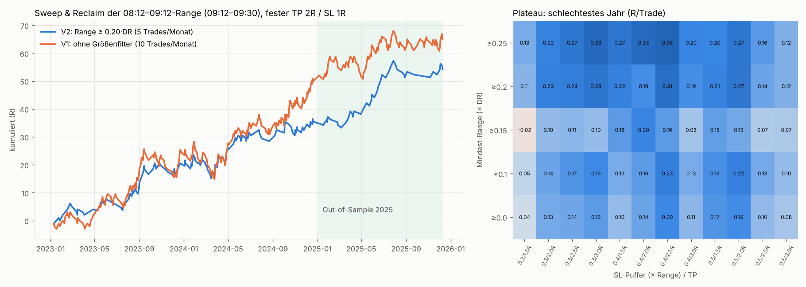

# NQ Phase 4: Range 08:12–09:12 ET mit festem TP/SL

Code: `research/p4/`, Pine: `research/pine/NQ_0812_0912_Sweep_Reversal.pine`, Trade-Liste zum Abgleich: `output/p4_V2_trade_list.csv`.
Konventionen wie bisher: 1-min-Bars mit Bar-Start-Zeit ET, Entry zum nächsten Open, **Stop zuerst** bei SL und TP im selben Bar, TP nur mit Trade-through um 1 Tick, Gap-Fills zum schlechteren Open, Tageslimit ±1R, eine Position gleichzeitig. Ohne Trailing und ohne BE.

## Ergebnis

**Deine Vermutung stimmt: Bei dieser Range funktionieren Reversals, Continuation nicht.**

| | V2 (empfohlen): Range ≥ 0.20·DR | V1: ohne Größenfilter |
|---|---|---|
| Trades/Monat | 5.2 | 9.7 |
| Winrate | 43 % | 40 % |
| Ø Gewinn / Ø Verlust | +1.98R / −0.98R | +1.98R / −0.99R |
| **Expectancy brutto / netto (0.6 Pkt)** | **+0.30R / +0.28R** | +0.19R / +0.17R |
| 2023 / 2024 / **2025 (OOS)** | +0.37 / +0.19 / **+0.42** | +0.24 / +0.19 / +0.15 |
| Profit Factor | 1.54 | 1.32 |
| **Ohne beste 5 % Trades** | **+0.21R** | +0.09R |
| Max DD / längste Verlustserie | 8.5R / 7 | 13.6R / 9 |
| Positive Quartale | 11 von 12 | 9 von 12 |
| Median-Stop / Median-Dauer | 34 Pkt / 21 min | 27 Pkt / 17 min |
| Long / Short | +0.30 / +0.30 | +0.26 / +0.13 |
| Exits TP / SL / Zeit | 43 % / 54 % / 3 % | 39 % / 59 % / 2 % |
| Kosten 1 / 2 Pkt Roundtrip | +0.27 / +0.24R | +0.15 / +0.11R |

Walk-Forward (quartalsweise, Auswahl aus Mindest-Range × SL-Puffer × TP):
- Auswahl nach t-Wert: **+0.15R** OOS (WR 44 %).
- Auswahl nach Expectancy: **+0.52R** OOS (wenige Trades).

Das ist der **erste Kandidat der gesamten Research, der nicht an Ausreißern hängt**: ohne die besten 5 % der Trades bleiben +0.21R.



## Die Regeln (V2)
1. **Range:** Hoch und Tief der 1m-Bars, die zwischen 08:12 und 09:11 ET starten.
2. **Größenfilter:** Range ≥ 0.20 × DR. DR ist die Ø RTH-Range (09:30–16:00) der 10 vorherigen Sessions; bei NQ 2025 entspricht das grob ≥ 60–80 Pkt.
3. **Signalfenster 09:12–09:29 (Bar-Start):** Pro Seite eröffnet der *erste* Bar, der über das Range-Hoch bzw. unter das Range-Tief handelt, den Sweep, und das Sweep-Extrem wird mitgeführt. **Signal**, sobald ein 1m-Bar wieder *innerhalb* der Range schließt (auch derselbe Bar). Sweep oben → **Short**, Sweep unten → **Long**. Ein Signal pro Seite und Tag.
4. **Entry:** Market zum nächsten Open.
5. **SL:** Sweep-Extrem ± 0.4 × Range. **TP:** 2 × (Abstand Signal-Close ↔ SL). Beide fest.
6. **Exit**, falls weder SL noch TP getroffen: am Bar ab 15:54 ET (kommt in 3 % der Fälle vor).
7. **Tageslimit ±1R**, eine Position gleichzeitig.

## Wie es gefunden wurde (Beobachtung → Hypothese → Test)
- **Verhalten:** Die Range ist im Median 48–64 Pkt groß (≈ 0.23 DR). 55 % der ersten Ausbrüche fallen in 09:12–09:29, 16 % genau auf 09:30. Nach dem ersten Ausbruch läuft Price seltener weiter als im Random Walk: Er erreicht +0.25 × Range vor der Range-Mitte in 63 % der Fälle statt 67 %, in jedem Jahr darunter. Das ist eine leichte Reversal-Tendenz.
- **Continuation** (erster Close außerhalb, auch mit Retest; 560 Varianten, Fenster bis 09:30/10:00/10:30/11:30): **keine einzige** Variante ist in allen Jahren positiv, Median −0.08R. → verworfen.
- **Reversal Sweep & Reclaim** (6336 Varianten): Nur Signale **vor 09:30** funktionieren. Danach ist der Median negativ.
- **Halten durch die Cash-Eröffnung ist entscheidend:** Wer vor 09:30 flat geht, landet bei ≈ 0R. Der Pre-Open-Sweep ist ein Fake-out, und die Umkehr kommt mit dem 09:30-Volumen.
- **Stop:** Liegt er zu eng hinter dem Sweep-Extrem (+0.05 × Range), ist das Ergebnis überall negativ. Der Stop braucht ≥ 0.3 × Range Luft (dasselbe Muster wie in Phase 1–3).
- **Größenfilter:** Kleine Ranges (< 0.15 DR) sind negativ, große sind besser. Für jede Mindestgröße von 0 bis 0.25 DR sind **96–100 %** aller SL/TP-Kombinationen in allen Jahren positiv. Gewählt wurde die Plateau-Mitte (0.20), nicht der Bestwert.
- **Deine Uhrzeit ist nicht „magisch“, aber gut:** 08:00–09:12, 08:10–09:10 und 08:15–09:15 liefern dasselbe. 08:30–09:30 funktioniert nicht, weil das Signalfenster dann nach der Eröffnung liegt.
- **Verworfene Filter**, weil sie über die Jahre oder Stop-Varianten inkonsistent sind: Sweep-Tiefe, Seite (Long/Short), Sweep-Zeitpunkt 09:12–09:19 vs. 09:20–09:29.

## Schwächen
- **Wenige Trades:** ~5 pro Monat (V2). An 75 % der Tage gibt es keinen Trade.
- **2024 schwächer** (+0.19R). Längere Flautephasen sind möglich, etwa 2025-08 bis 2025-11 mit kaum Signalen.
- **Expectancy +0.30R** liegt knapp unter deinem früheren Ziel von +0.35R. Mit Mindest-Range 0.25 sind es ~+0.42R, dann aber nur ~3.4 Trades/Monat.
- **Pine vs. Research:** Research hat Halbtage ausgeschlossen. Der DR wird aus „gültigen“ Sessions berechnet (leichte Abweichung möglich). Bei einem Bar, der SL und TP in derselben Minute berührt, nimmt TradingView einen eigenen Intrabar-Pfad an, die Research zählt ihn als SL. Das Script wurde hier nicht in TradingView kompiliert. Bei Fehlermeldungen kurz Bescheid geben.

## Reproduzieren
```
cd research/p4
python3 behavior.py; python3 grid4.py; python3 robust4.py; python3 filters4.py; python3 sizefilter.py; python3 final4.py; python3 charts4.py
```
